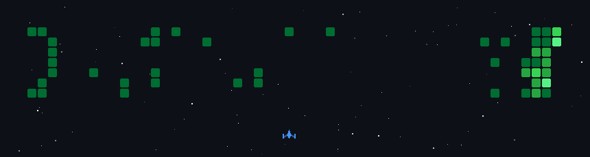

<h1 align="center">Hey, I'm Tejas Rastogi 👋</h1>

<picture>
  <source media="(prefers-color-scheme: light)" srcset="https://readme-typing-svg.demolab.com?font=Fira+Code&weight=600&size=22&pause=1000&color=059669&center=true&vcenter=true&width=760&height=50&lines=Building+microservices+with+Spring+Boot+%26+Kafka;Shipping+RAG+pipelines+%26+autonomous+AI+agents;Turning+ideas+into+real-time+full-stack+apps;Backtesting+alpha+signals+with+Python+%26+Numba">
  
</picture>

<picture>
  <source media="(prefers-color-scheme: light)" srcset="https://readme-typing-svg.demolab.com?font=Fira+Code&weight=600&size=30&pause=1000&color=24292F&center=true&vcenter=true&width=760&height=60&lines=Let+me+tell+you+a+fun+fact...">
  
</picture>

 

  
  
  
  
  
  

  
  
  
  
  
  

  
  
  

---

<h1 align="center">🎬 It's Intro Time</h1>

### I build backend systems that stay correct under load, and AI systems that can be measured, not just demoed.

I'm a pre-final year Computer Science student at **KIET, Ghaziabad (2024 – 2028)**, and I treat my college as a starting point, not a ceiling. What I can build, test and prove matters more to me than the name on a certificate, so I spend my time shipping real systems and measuring them honestly.

### What that looks like in practice

- **Backend that doesn't break:** a core banking engine with deadlock-safe atomic transfers and 61 tests, plus a Kafka + Eureka microservices trading platform with JWT auth, wallets, orders and portfolios.
- **AI with numbers behind it:** an autonomous strategy agent scored on a 39-case harness (**92%** pass on gpt-oss-120b vs **28%** on a local 7B model), and a hybrid-RAG workspace with BM25 + dense search, reranking and RAGAS quality checks.
- **Performance I can show:** a Numba-compiled backtester that runs **25,000+ parameter combinations in under a second**, backed by 104 tests.
- **Research discipline:** **140+ alpha signals** at WorldQuant Brain, validated out-of-sample with walk-forward testing.
- **Full-stack range:** real-time apps in React, Node, Socket.IO and Laravel.

### What I care about

Correctness under concurrency, clean architecture, tests that actually fail when something breaks, and numbers I can defend. I also compete: **Top 45** at Hack the Throne 2026 and Round 2 at the ForkIT Challenge (IIIT Delhi).

If a problem needs to be reliable, fast and measurable, that's the kind I like working on.

---

## 🧭 Overview

<table>
  <tr>
    <td width="50%" valign="top">
      <h3>⚙️ Backend & Distributed Systems</h3>
      Spring Boot microservices with Eureka, API Gateway, Kafka and JWT. Transactional ledgers with row-level locking, Redis caching, and versioned database migrations.
    </td>
    <td width="50%" valign="top">
      <h3>🧠 AI, RAG & Agents</h3>
      Hybrid search (dense + BM25 with RRF), cross-encoder reranking, RAGAS evaluation, tool-calling agents with sandboxed execution, and MCP tool integration.
    </td>
  </tr>
  <tr>
    <td width="50%" valign="top">
      <h3>🌐 Full-Stack & Real-Time</h3>
      React 19 + Vite frontends, Node/Express and Laravel backends, live state sync over WebSockets and Socket.IO.
    </td>
    <td width="50%" valign="top">
      <h3>📈 Quant & Data</h3>
      140+ alpha signals researched at WorldQuant Brain, backtesting, walk-forward validation, and Numba-accelerated computation.
    </td>
  </tr>
</table>

---

## 🛠 Skills

 

 

  

| | |
| :--- | :--- |
| **Languages** | Python · Java · C++ · TypeScript · JavaScript · PHP · C# · SQL |
| **Backend** | Spring Boot · FastAPI · Node.js · Laravel · ASP.NET Core · Kafka · REST |
| **AI / LLM** | RAG · Hybrid Search · Reranking · RAGAS · LangChain · LangGraph · MCP · Ollama · vLLM |
| **Data stores** | PostgreSQL · Redis · MongoDB · SQLite · ChromaDB |
| **Tooling** | Docker · GitHub Actions · Pytest · Linux · Git · Numba |

---

## 📂 Featured Projects

<table>
  <tr>
    <td width="50%" valign="top">
      <h3 align="center">🏦 <a href="https://github.com/tejasrastogileet/BankingAPi">BankingAPi</a></h3>
      
<b>Core Banking & Ledger Engine</b>

      <ul>
        <li><b>Stack:</b> Java 17, Spring Boot 3, PostgreSQL, Redis 7, Flyway, Bucket4j</li>
        <li>Deadlock-safe atomic transfers via canonical row-lock ordering (<code>min(id) → max(id)</code>).</li>
        <li>DB-level balance invariants, distributed caching, rate limiting, 61 tests.</li>
      </ul>
    </td>
    <td width="50%" valign="top">
      <h3 align="center">📈 <a href="https://github.com/tejasrastogileet/TradeFlux">TradeFlux</a></h3>
      
<b>Microservices Trading Platform</b>

      <ul>
        <li><b>Stack:</b> Spring Boot, PostgreSQL, Kafka, Eureka, API Gateway</li>
        <li>JWT authentication, wallet management, order processing, portfolio tracking.</li>
        <li>Service discovery and centralized routing across independent services.</li>
      </ul>
    </td>
  </tr>
  <tr>
    <td width="50%" valign="top">
      <h3 align="center">🧪 <a href="https://github.com/tejasrastogileet/AlphaEval">AlphaEval</a></h3>
      
<b>Autonomous Strategy Agent & Eval Engine</b>

      <ul>
        <li><b>Stack:</b> Python, FastAPI, Numba, Ollama, Pytest</li>
        <li>Tool-calling agent with AST verification and subprocess sandboxing.</li>
        <li>39-case eval harness: <b>92%</b> pass on gpt-oss-120b vs <b>28%</b> on local Qwen2.5-Coder 7B.</li>
        <li>Numba backtester: 25,000+ parameter combos in under 1 second, 104 tests.</li>
      </ul>
    </td>
    <td width="50%" valign="top">
      <h3 align="center">🔎 <a href="https://github.com/tejasrastogileet/Nexus">NexusMind</a></h3>
      
<b>Enterprise RAG Knowledge Workspace</b> · <a href="https://nexusmind-3zd.pages.dev/">Live Demo</a>

      <ul>
        <li><b>Stack:</b> Python, FastAPI, ChromaDB, BM25, Docker</li>
        <li>Hybrid search (dense + BM25 via RRF), cross-encoder reranking, SSE streaming with citations.</li>
        <li>Per-user workspace isolation and automated RAGAS evaluation.</li>
      </ul>
    </td>
  </tr>
  <tr>
    <td width="50%" valign="top">
      <h3 align="center">🧠 <a href="https://github.com/tejasrastogileet/MediaNova">MediaNova</a></h3>
      
<b>Agentic AI & Query Routing Engine</b>

      <ul>
        <li><b>Stack:</b> Python, FastAPI, Pydantic, ChromaDB, MCP, OpenTelemetry</li>
        <li>Semantic query routing, contextual RAG retrieval, dynamic MCP tool integration.</li>
        <li>Multi-stage prompt-injection guardrails with execution tracing.</li>
      </ul>
    </td>
    <td width="50%" valign="top">
      <h3 align="center">💻 <a href="https://github.com/tejasrastogileet/Mingle">Mingle / HireBoard</a></h3>
      
<b>Real-Time Collaborative Coding Platform</b>

      <ul>
        <li><b>Stack:</b> React 19, Vite, Node.js, Express, Socket.IO, MongoDB</li>
        <li>Pair-programming editor with live keystroke broadcast.</li>
        <li>In-memory socket state with automatic database fallback.</li>
      </ul>
    </td>
  </tr>
  <tr>
    <td width="50%" valign="top">
      <h3 align="center">🎙️ <a href="https://github.com/tejasrastogileet/Syncora">Syncora</a></h3>
      
<b>Async Audio Processing & Workspace</b>

      <ul>
        <li><b>Stack:</b> PHP, Laravel 11, Livewire 3, Laravel Reverb</li>
        <li>Queued workers for audio ingestion and note transcription.</li>
        <li>Real-time UI updates over WebSockets, no polling.</li>
      </ul>
    </td>
    <td width="50%" valign="top">
      <h3 align="center">📬 More</h3>
      
Everything else lives in my repositories.

      

    </td>
  </tr>
</table>

---

## 💼 Experience & Achievements

**Quantitative Research Consultant · WorldQuant Brain** *(Apr 2026 – Oct 2026, Remote)*
Researched and backtested 140+ alpha signals, targeted Sharpe > 1.6 with turnover < 20%, and validated them with out-of-sample walk-forward tests.

🏆 **Hack the Throne 2026**: Top 45 teams, national-level hackathon
🏆 **ForkIT Challenge (IIIT Delhi)**: Qualified for Round 2

---

## 📊 GitHub Stats

  

### 🏙️ 3D Contribution City

  

### 🚀 Contribution Space Shooter

<!-- TODO: after the space-shooter workflow runs, set the file name/branch below to match its output -->

  

### 🔭 What I'm Up To

<table>
  <tr>
    <td width="33%" valign="top" align="center">
      <h4>🔨 Building</h4>
      Microservices with Spring Boot, Kafka and Eureka, plus RAG and agent pipelines in Python.
    </td>
    <td width="33%" valign="top" align="center">
      <h4>📚 Exploring</h4>
      RAG evaluation (RAGAS), agent tool-calling, MCP, and concurrency-safe database design.
    </td>
    <td width="33%" valign="top" align="center">
      <h4>🎯 Goal</h4>
      Ship small, tested, well-documented projects and grow with every commit.
    </td>
  </tr>
</table>

